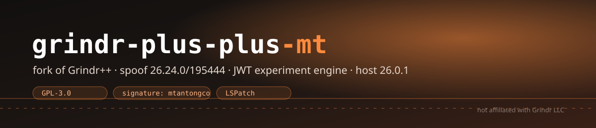

<p align="center"></p>

# grindr-plus-plus-mt

**A fork of Grindr++ with a version-spoof bake-in and a client-side A/B experiment engine.**

Signed with `mtantongco`. Built on GrindrPlus v5.0.1 for host **26.0.1 (149389)**.
Not affiliated with Grindr LLC.

> **Fork notice.** This tree descends from
> [fatterdev/grindr-plus-plus](https://github.com/fatterdev/grindr-plus-plus) →
> [R0rt1z2/GrindrPlus](https://github.com/R0rt1z2/GrindrPlus) →
> [ElJaviLuki/GrindrPlus](https://github.com/ElJaviLuki/GrindrPlus), and its hooks come from
> [gustarmartins/GrindrPlus](https://github.com/gustarmartins/GrindrPlus) v5.0.1 (`c43f6c4`).
> Full attribution: [NOTICE](NOTICE). GPL-3.0.

## What this fork adds

| Change | Why |
|---|---|
| Spoof defaults **compiled** to `26.24.0 / 195444` | the Nov-2026 login gate; survives a config wipe |
| `AssignmentsInterceptor` rewrites the session **JWT `experiments`** map | client-side A/B override from config keys |
| Docs: timeline, superpowers, both install levels, diagrams | the upstream README assumes you already know the mod |

## Quick start

- **New to this?** → [docs/INSTALL-BEGINNER.md](docs/INSTALL-BEGINNER.md)
- **Have adb?** → [docs/INSTALL-EXPERT.md](docs/INSTALL-EXPERT.md)
- **How it works** → [docs/ARCHITECTURE.md](docs/ARCHITECTURE.md)
- **What it can do** → [docs/SUPERPOWERS.md](docs/SUPERPOWERS.md)
- **What shipped when** → [docs/RELEASE-TIMELINE.md](docs/RELEASE-TIMELINE.md)

## The one rule

Edit config only with **both apps force-stopped**. The manager rewrites
`grindrplus.json` from memory while running and will silently undo your edit.

```bash
adb shell am force-stop com.grindrplus && adb shell am force-stop <clonePkg>
# edit, push
adb shell monkey -p <clonePkg> -c android.intent.category.LAUNCHER 1
```

## Supported host

`26.0.1 / 149389` only. Each Grindr bump invalidates obfuscated symbols; hooks
soft-fail to a silent partial rather than crashing. After any update, open
**Status Dialog** — a skipped hook is not a working hook.

## Known limits

Server-enforced, no client fix: **"Viewed Me"**, true incognito, message-send
entitlement, age verification. Region spoofing (Honduras/Nigeria) is the only
lever that reaches the 402 tier — see [docs/SUPERPOWERS.md](docs/SUPERPOWERS.md#5-geographic-tier-bypass).

## Signing

`mtantongco.keystore` — alias `mtantongco`, pass `mtantongco`. A different
signature from upstream release and debug builds: **uninstall before switching**.
Losing this key forces the uninstall dance on every future build.

## Licence

GPL-3.0 — see [LICENSE](LICENSE). Credit the lineage if you ship a derivative;
do not present this tree as the archived GrindrPlus project.
