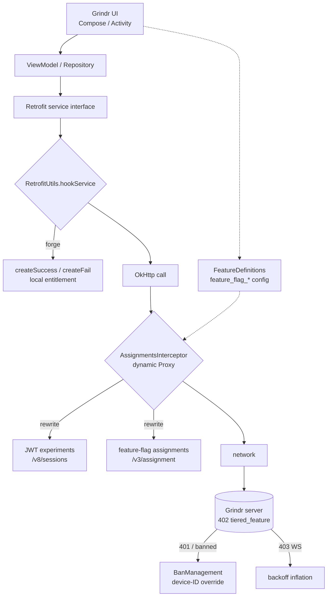
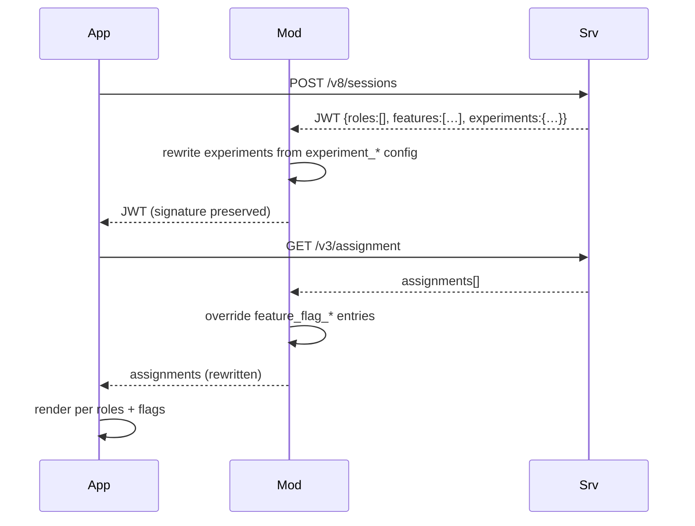
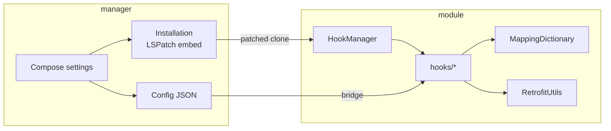

# Architecture

Request path and where each layer can be intercepted. Read top-down: the app asks,
the mod rewrites, the server answers.

## Layers

| Layer | Component | Can change | Cannot change |
|---|---|---|---|
| UI | hook classes (`EnableUnlimited`, `UnlimitedAlbums`, …) | visibility, tab removal, paywall suppression | what the server sends |
| Wire | `AssignmentsInterceptor`, `RetrofitUtils`, `UnlimitedAlbums` | flags, experiments, response bodies, album fetch endpoint | signed payloads it does not rewrite |
| Identity | `BanManagement`, `SignatureSpoofer`, version spoof | android_id, UA, app version claims | ban decisions |
| Storage | `ExpiringMedia`, `MediaUtils` | keep media past expiry | server-side retention |

## Entitlement flow

The client trusts the payload; the server never re-issues it for a session already
handed out. That gap is the whole attack surface.

## Forged-response failure paths

A forge that only handles the happy path turns a server refusal into a blank screen.
`UnlimitedAlbums.handleGetAlbum` is the pattern to copy:

1. call the endpoint the app itself calls (`v2/albums/{albumId}`; `v1` answers a bare
   `404` integer body, which `JSONObject` rejects);
2. branch on `code in 200..299` before touching the body;
3. on any non-2xx, empty body, or missing result object, fall back to the local
   album DB instead of returning the untouched error.

Skipping step 2 is what produced `Value 404 of type java.lang.Integer cannot be
converted to JSONObject` on every unentitled album.

## Why hooks soft-fail

Every obfuscated symbol is resolved through `MappingDictionary`
(remote pack → device cache → bundled assets → literal). A miss logs and skips
rather than crashing the host. Consequence: **silent partial function**. Check
`Status Dialog` after any Grindr update — a skipped hook is not a working hook.

## Component map

