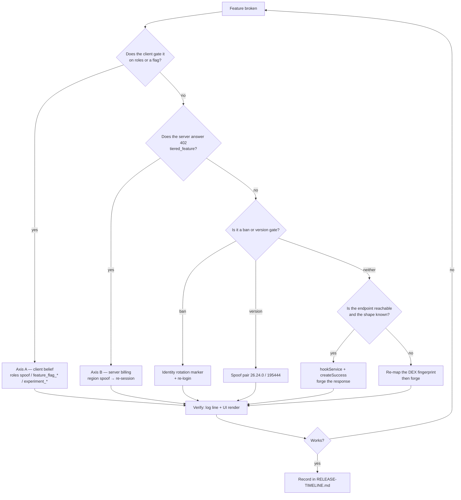

# Bypass decision diagram

Use before touching any broken feature. The branch point decides whether code or
config is the right lever.

## Axis cheat sheet

| Axis | Lever | Cost | Reversible |
|---|---|---|---|
| A — client belief | config keys | seconds | yes, delete key |
| B — server billing | location marker | seconds | yes, revert coords |
| Identity | regen marker | seconds | no — old ID retired |
| Wire | Kotlin + rebuild | ~2 min | yes, revert commit |
| Mapping | DEX re-analysis | minutes–hours | yes |

## Anti-patterns

- Editing config while the manager runs — it overwrites from memory
- Rotating identity on a schedule — looks like a farm
- Forcing a flag the server also validates, then blaming the client
- Treating a skipped hook as a pass
